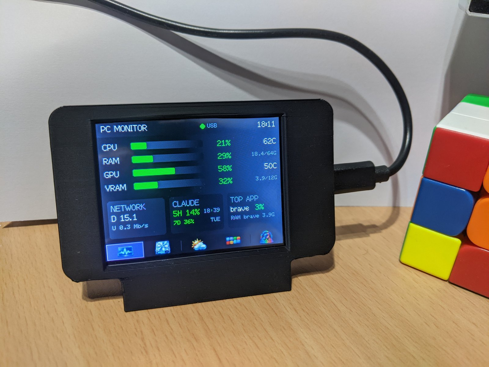
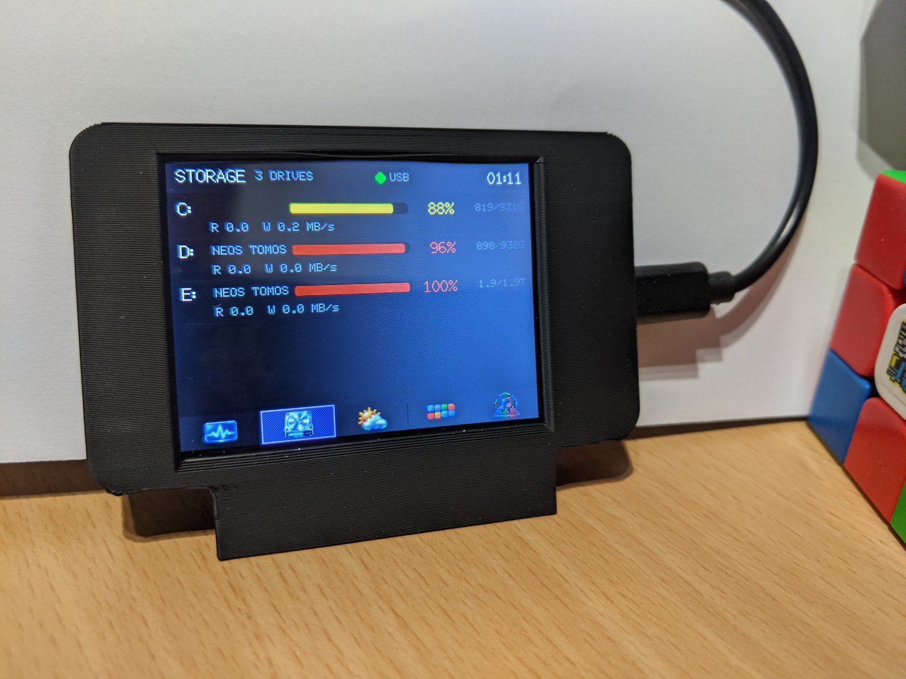
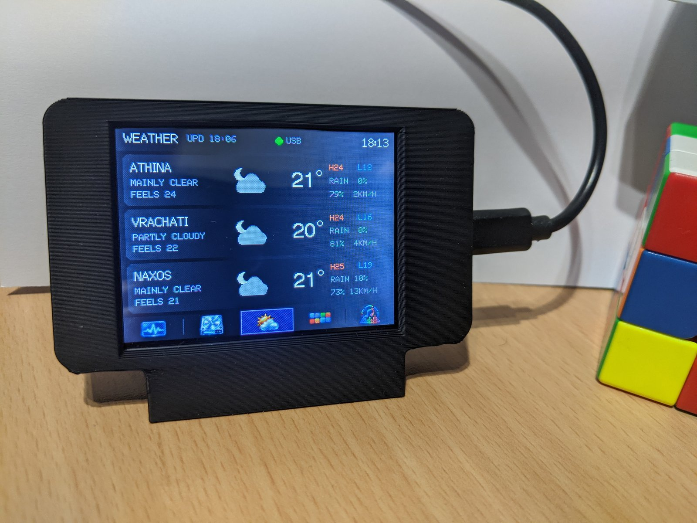
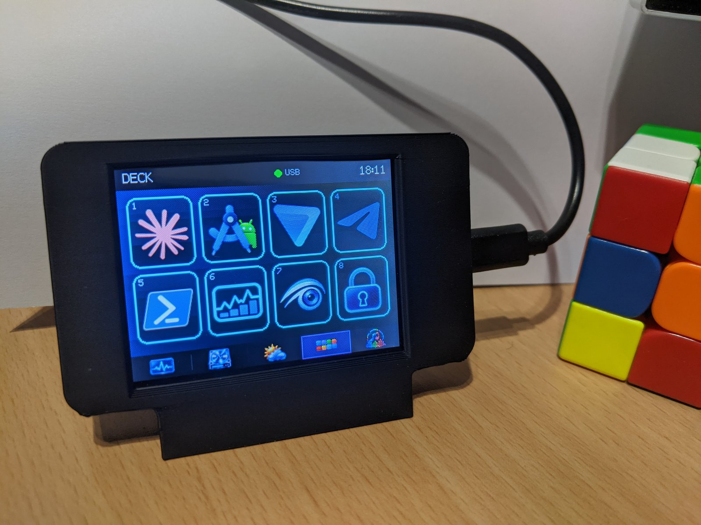
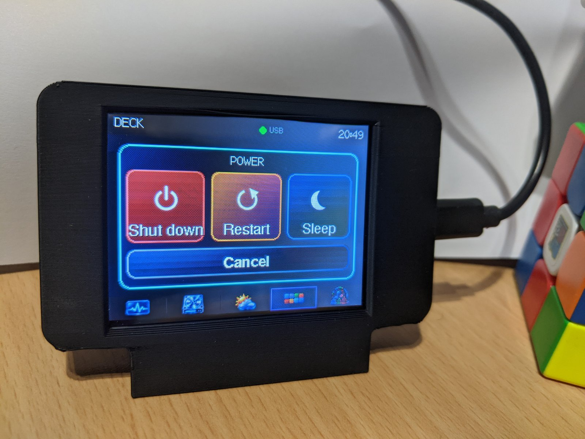
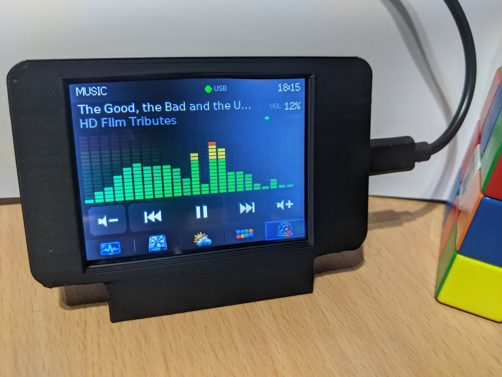

# PC Deck (CYD)

A USB-connected ESP32 Cheap Yellow Display that monitors a Windows computer and works as a small touch control panel.

The project turns the NMMiner NerdMiner V2 Hashrate Lucky Miner ESP32 2.8 inch Smart Display Crypto Solo Lottery 960KH/s Bitcoin ESP32-2432S028R DROOM into a practical desk device. One USB cable powers the ESP32, sends live telemetry from the PC to the screen and sends touch-button events back to the computer. No Wi-Fi or Bluetooth is required.



## Features

### Monitor

- CPU usage
- RAM usage and used/total memory
- GPU usage
- VRAM usage and used/total memory
- GPU temperature through NVIDIA NVML (`nvidia-ml-py`)
- optional CPU, system and storage temperatures through LibreHardwareMonitor
- network download and upload speed
- top process: the program using the most CPU and the one using the most RAM
- Claude plan usage (5-hour session and weekly limit) — needs Claude Code installed and logged in once (`claude`); uses an unofficial endpoint that may change. Test with `control_deck_bridge.py --test-claude-usage`. The bridge renews the Claude Code login automatically when it expires (Claude Code renews only an expired login) by starting `claude` hidden in `~/claude-login`; create that folder and run `claude` there once to mark it as trusted
- PC clock synchronized from the host bridge
- USB status and stale-data indicator
- screen sleep: backlight turns off when the PC is off or asleep; tap to wake

### Storage



- separate Storage page with every local drive: letter, volume label, usage bar, percentage and used/total size, plus read/write speed under each drive (5 drives per screen, tap for more)

### Weather



- current temperature, condition icon, feels-like, today's high/low, rain probability, humidity and wind
- up to six places (three per screen, tap to switch)
- data from the free [Open-Meteo](https://open-meteo.com/) API, no API key; the PC needs internet access

### Deck



The default control page contains eight buttons (two rows of four):

| Button | Default action |
| --- | --- |
| Claude | Start the Claude desktop app |
| Android Studio | Start Android Studio |
| Proton VPN | Start Proton VPN |
| Telegram | Start Telegram Desktop |
| PowerShell | Open PowerShell in your user folder |
| Task Manager | Open Task Manager |
| O-KAM PRO | Start the O-KAM Pro camera app |
| Lock PC | Lock the PC (hold for the power menu) |

Each button shows its number and its icon in full colour, without a label (icons from `icons/`, converted with `tools/make_button_icons.py`; see `docs/MACROS.md`). All labels and actions are configured in `host/config.json`. The example configuration is safe to publish.

#### Power menu



Hold the Lock PC button for 1.5 s (it fills red) to open a menu with Shut down, Restart, Sleep and Cancel. Shut down and Restart count down 5 s with a large CANCEL button; Sleep happens at once. A short tap still locks the PC.

### Music Visualizer



- separate Music page (5th tab) with a spectrum of the sound the PC plays (24 bars), the song title and artist from the Windows media controls (Spotify, YouTube in a browser, etc.; Greek letters included), the system volume and buttons for volume down/up, previous, play/pause and next
- the bridge records the default output device only while the Music page is on screen, in a separate worker process
- needs the packages in `host/requirements.txt` (numpy, PyAudioWPatch, pycaw, winrt); `host\run_windows.bat` installs them, also after an update
- the title font with Greek letters is made by `tools/make_smooth_font.py`
- title and artist are shown only while music plays
- 10 effects for the spectrum: 1 LED, 2 solid bars, 3 mirror, 4 dots, 5 wave, 6 oscilloscope, 7 fire, 8 ocean, 9 circle, 10 spikes; tap the bars for the next one (its name shows for a second, the choice is kept on the display)

### 3D printed case

https://makerworld.com/en/models/2233508-case-nerdminer-esp32-2432s028-snap-fit-cyd-2-8#profileId-2430391

## How it works

```text
PC
- reads CPU, RAM, GPU, network and disk data
- optionally reads sensors from LibreHardwareMonitor
- sends telemetry over USB serial
- executes trusted local actions from config.json
- records the sound and reads the current song for the Music page

USB serial through CH340

ESP32 display
- shows live PC statistics
- shows eight touch buttons
- sends a numeric macro ID, power actions, media keys and the current page back to the PC
```

The board uses a classic ESP32-WROOM-32 and a CH340 USB-to-UART bridge. It does not expose native USB HID keyboard support through the USB-C port. Keyboard-like actions are handled by the local host bridge after the ESP32 sends a macro ID.

## Target hardware

This project was created for this device:

```text
NMMiner NerdMiner V2 Hashrate Lucky Miner ESP32 2.8 inch Smart Display Crypto Solo Lottery 960KH/s Bitcoin ESP32-2432S028R DROOM
```

Product page:

```text
https://www.aliexpress.com/item/1005008586959136.html
```

Tested hardware summary:

- 2.8-inch ESP32 miner-style LCD display
- ESP32-WROOM-32-N4 module
- 320x240 ILI9341V TFT
- XPT2046 resistive touch controller
- CH340 USB serial bridge

The pinout doesn't match the hardware used in the [ESP32 PC Control Deck](https://github.com/lepczynski-cloud/ESP32-PC-Control-Deck).

See `docs/HARDWARE.md` for pinout details.

## Requirements

- Windows 10 or 11 (tested on Windows 10)
- [Python 3](https://www.python.org/downloads/) (tested with 3.14); during installation tick **Add python.exe to PATH**
- [Visual Studio Code](https://code.visualstudio.com/) with the [PlatformIO IDE](https://platformio.org/install/ide?install=vscode) extension, to build and upload the firmware
- the CH340 USB driver (step 2 below)
- a USB data cable (not a charge-only cable)
- optional: an NVIDIA GPU for GPU usage and temperature, [LibreHardwareMonitor](https://github.com/LibreHardwareMonitor/LibreHardwareMonitor) for CPU and other temperatures, Claude Code for the Claude usage box

## Setup guide

### 1. Download the project

On the GitHub page of this repository choose **Code -> Download ZIP** and extract it (or `git clone` it). Keep the folder; the bridge runs from it.

### 2. Install the CH340 driver (CH341SER.EXE)

Download and install the driver from this page:

https://www.wch-ic.com/downloads/CH341SER_EXE.html

### 3. Flash the firmware

Open the folder in VS Code with the PlatformIO IDE extension and use first **Build** and then **Upload** (or run):

```bash
pio run                                   # default: cyd2usb
pio run -t upload --upload-port COM5      # use your board's COM port
```

Environments: `cyd2usb` (ESP32-2432S028 with USB-C + micro USB, default), `cyd` (ESP32-2432S028R, micro USB only), `esp32_pc_control_deck` (Elecrow board). Select another one with `-e <name>` or from the environment picker in the PlatformIO status bar.

On first boot, touch the three marked points with the stylus to calibrate the touch panel. The calibration is saved in ESP32 preferences.

### 4. Start the host bridge

Run:

```text
host\run_windows.bat
```

On the first run, the script creates a virtual environment, installs Python dependencies, copies `config.example.json` to `config.json`, and starts the bridge. All settings are in `host/config.json` (see [`docs/CONFIGURATION.md`](docs/CONFIGURATION.md)).

### 5. Temperatures

https://github.com/LibreHardwareMonitor/LibreHardwareMonitor

Windows usually does not expose CPU temperature through `psutil`. For more sensors, download LibreHardwareMonitor, run it as administrator and enable:

```text
Options -> Remote Web Server -> Run
```

The bridge reads:

```text
http://127.0.0.1:8085/data.json
```

To list detected temperature sensors:

```text
host\.venv\Scripts\python.exe host\control_deck_bridge.py --list-temperatures --config host\config.json
```

If no CPU temperature is available, the display uses a clear fallback:

- CPU row: `TEMP N/A` or `SYS xxC`
- RAM row: used/total memory
- GPU row: GPU temperature or `TEMP N/A`
- VRAM row: used/total memory

### 6. Start automatically with Windows

Run `host/run_windows.bat` once, then execute from the repository root:

```powershell
powershell -ExecutionPolicy Bypass -File .\host\install_autostart_windows.ps1
```

Remove the startup shortcut with:

```powershell
powershell -ExecutionPolicy Bypass -File .\host\uninstall_autostart_windows.ps1
```

## Configuration

Everything is set in your local, git-ignored `host/config.json` (created from `config.example.json` on first run). After a change, restart the bridge; the firmware does not need to be uploaded again.

See [`docs/CONFIGURATION.md`](docs/CONFIGURATION.md) for every setting: serial port, screen sleep, storage, weather places, buttons, power menu and music.

## Serial protocol

The protocol uses newline-delimited JSON frames prefixed with `DD:`.

Example:

```text
DD:{"type":"stats","cpu":18.2,"ram":61.7}
```

The prefix prevents ESP32 boot messages from being parsed as application JSON. See `docs/PROTOCOL.md` for details.

## Security notes

- The ESP32 stores no passwords, browser cookies, API keys or account credentials.
- The ESP32 sends only a macro ID from 1 to 8, the power actions shutdown/restart/sleep, media keys and the name of the current page.
- The host bridge executes only actions configured locally in `host/config.json`.
- Keep `host/config.json` out of Git if it contains local paths or private commands.

See `SECURITY.md` for more details.

## License

MIT. See `LICENSE`.

Based on the MIT-licensed [ESP32 PC Control Deck](https://github.com/lepczynski-cloud/ESP32-PC-Control-Deck) by Wojciech Lepczynski; all changes are listed in `CHANGELOG.md`. The Music page font is rendered from DejaVu Sans (license in `src/media_font.h`).

App logos in `icons/` (Claude, Android Studio, Proton VPN, Telegram, PowerShell, O-KAM) are trademarks of their respective owners and are used only to identify the apps the buttons start.
